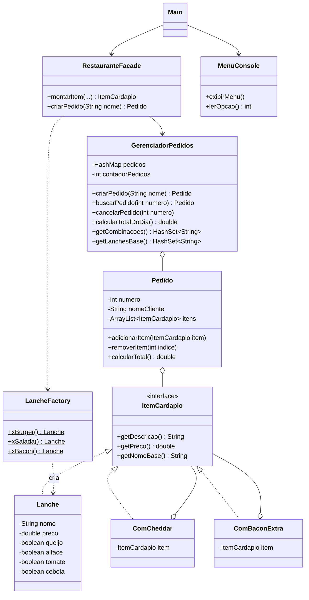

# Sistema de Restaurante em Java


Projeto desenvolvido no **ElasTech**, bootcamp gratuito de tecnologia voltado para mulheres, realizado pelo PagBank em parceria com a [SoulCode Academy](https://soulcode.com/).

É um sistema de restaurante via console, com cardápio, pedidos, personalização de lanches e fechamento do dia, construído com Programação Orientada a Objetos em Java.

## Funcionalidades

- Registrar pedidos com um ou mais lanches
- Retirar ingredientes (queijo, alface, tomate, cebola) sem alterar o preço
- Adicionais pagos: cheddar (+R$ 4,00) e bacon extra (+R$ 6,00)
- Modificar pedidos: acrescentar item, remover item ou cancelar
- Fechamento do dia com total vendido, combinações diferentes e lanches base
- Tratamento de entrada inválida (o sistema avisa e continua rodando)

## Exemplo de uso

```
=== RESTAURANTE ===
1 - Registrar novo pedido
2 - Listar pedidos do dia
3 - Fechar restaurante
4 - Modificar pedido
0 - Sair
Escolha: 1
Nome do cliente: Sofia
Qual lanche? 3
Retirar cebola? (s/n) s
Adicionar cheddar (+R$ 4,00)? (s/n) s
...
Pedido 1 - Sofia
  X-Bacon sem cebola + cheddar - R$ 26,00
  Total: R$ 26,00
```

## Estrutura

```
src/main/java
├── app        → Main, MenuConsole, RestauranteFacade
├── cardapio   → Lanche, ItemCardapio, LancheFactory, adicionais
└── pedido     → Pedido, GerenciadorPedidos
```

- **app:** o menu conversa com a pessoa, a fachada coordena as operações e o Main controla o fluxo
- **cardapio:** tudo que é vendido e como é montado
- **pedido:** as comandas e o controle de todos os pedidos do dia

## Diagrama de classes



## Padrões de projeto

| Padrão | Onde | Para quê |
|---|---|---|
| Factory | `LancheFactory` | Cria os lanches do cardápio, sempre um objeto novo |
| Decorator | `ComCheddar`, `ComBaconExtra` | Acrescenta adicionais sem alterar a classe `Lanche` |
| Facade | `RestauranteFacade` | Centraliza as operações entre o menu e as classes de negócio |

## Como rodar

Requer Java 17 e Maven.

1. Clonar o repositório
2. Abrir no IntelliJ
3. Executar `app.Main`

## Testes

Testes em JUnit 5, em `src/test/java`. Para rodar: botão direito na pasta `test/java` → Run 'All Tests', ou:

```
mvn test
```