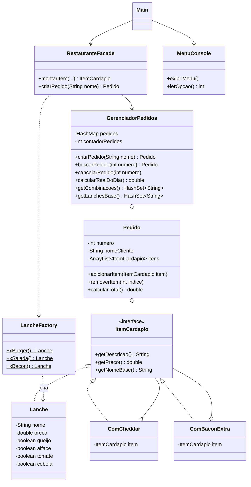

# sistema-restaurante-java
Sistema de restaurante em Java com POO: cardápio, pedidos, personalização de lanches e fechamento do dia. Usa Factory, Decorator e Facade, com testes em JUnit 5.
# Sistema de Restaurante em Java

Projeto desenvolvido no **ElasTech**, bootcamp gratuito de tecnologia voltado para mulheres, realizado pelo PagBank em parceria com a [SoulCode Academy](https://soulcode.com/).

É um sistema de restaurante via console, com cardápio, pedidos, personalização de lanches e fechamento do dia, construído com Programação Orientada a Objetos em Java.

# Sistema de Restaurante em Java

Projeto da disciplina de POO: um sistema de restaurante via console, com cardápio, pedidos, personalização de lanches e fechamento do dia.

## Funcionalidades

- Registrar pedidos com um ou mais lanches
- Retirar ingredientes (queijo, alface, tomate, cebola) sem alterar o preço
- Adicionais pagos: cheddar (+R$ 4,00) e bacon extra (+R$ 6,00)
- Modificar pedidos: acrescentar item, remover item ou cancelar
- Fechamento do dia com total vendido, combinações diferentes e lanches base
- Tratamento de entrada inválida (o sistema avisa e continua rodando)

## Estrutura

- `app` → `Main`, `MenuConsole` (interação com o usuário) e `RestauranteFacade` (coordena as operações)
- `cardapio` → `Lanche`, `ItemCardapio`, `LancheFactory` e os adicionais
- `pedido` → `Pedido` e `GerenciadorPedidos`

## Diagrama de classes

## Padrões de projeto

- **Factory:** `LancheFactory` cria os lanches do cardápio, sempre um objeto novo
- **Decorator:** `ComCheddar` e `ComBaconExtra` envolvem um item e somam preço e descrição
- **Facade:** `RestauranteFacade` centraliza as operações entre o menu e as classes de negócio

## Como rodar

Requer Java 17 e Maven.

1. Abrir o projeto no IntelliJ
2. Executar `app.Main`

## Testes

Testes em JUnit 5, em `src/test/java`. Para rodar: botão direito na pasta `test/java` → Run 'All Tests', ou:

    mvn test